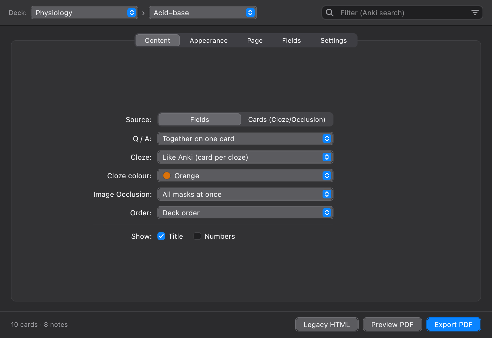
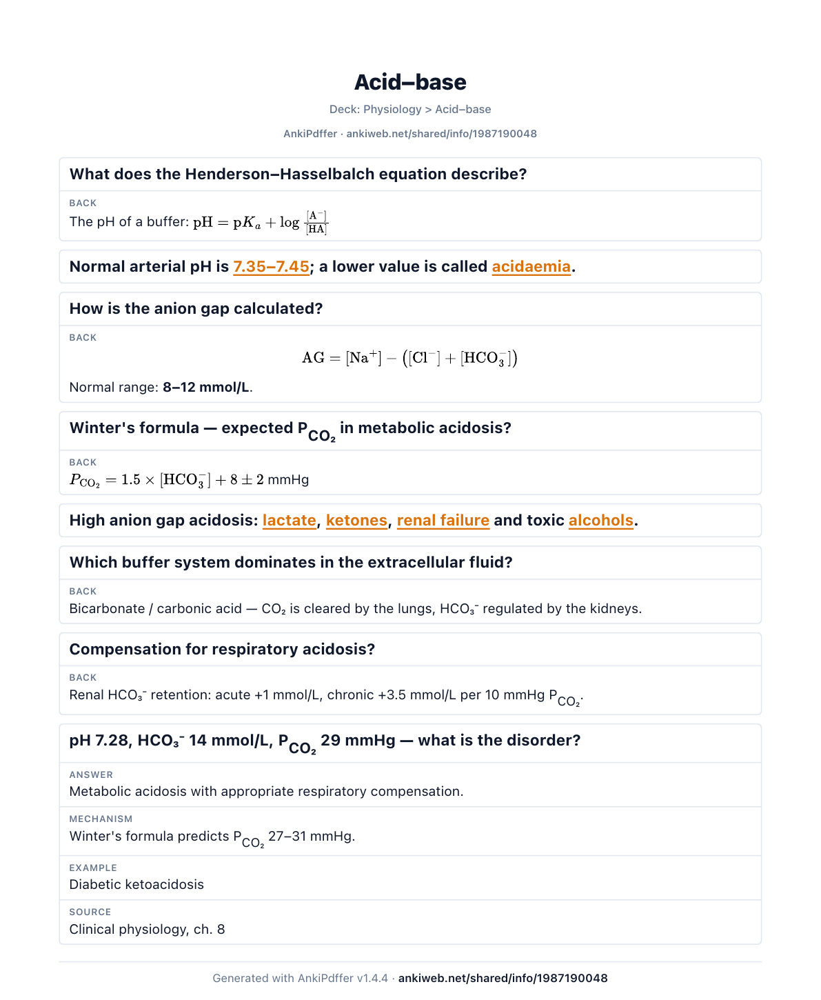
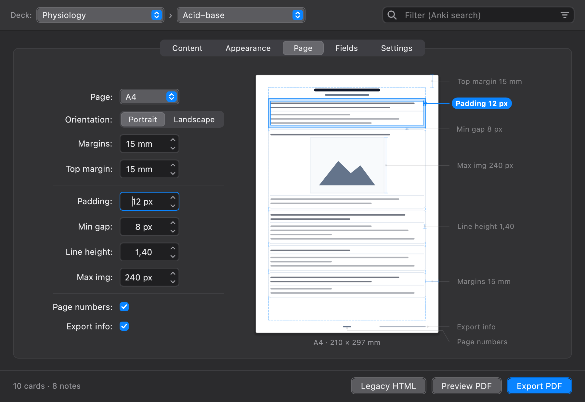
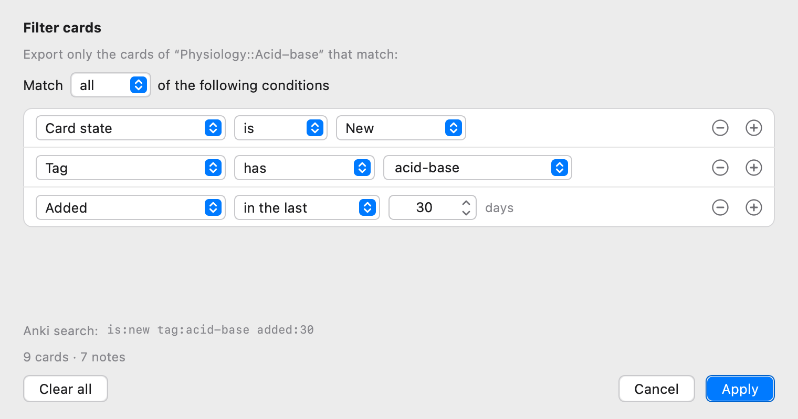

# AnkiPdffer

Export Anki decks to polished, print-ready PDFs or a single offline HTML file.

AnkiPdffer turns flashcards into clean documents for printing, offline study, sharing and archiving — real page layout, formulas, cloze highlighting and Image Occlusion, from a native-looking window inside Anki.

<p align="center">
  
  
</p>

**Install:** in Anki choose *Tools → Add-ons → Get Add-ons…* and enter **1987190048**, or download `AnkiPdffer-1.4.4.ankiaddon` from the [latest release](https://github.com/Janolm3/ankipdffer/releases/latest) and use *Install from file…*. Then open a deck and click **Export to PDF**, or use *Tools → AnkiPdffer*.

---

## Key Features

### Print-ready PDFs

<p align="center">
  
</p>

- **Real page layout** (WeasyPrint): A4, A5, A3 or Letter in portrait or landscape, margins, card padding and gaps, page numbers. Cards break across pages only where it saves space, never inside a field.
- **Formulas**: MathJax `\(…\)` and `\[…\]` are drawn as sharp vector graphics, inline with the text or centred for display math.
- **Cloze**: answers highlighted in the theme colour or a colour of your choice, hidden as `[...]` for worksheets, or one card per cloze as in Anki.
- **Looks**: light, dark and *Pro* themes, five card styles, compact or standard density, any system font.
- **Preview PDF** renders exactly what *Export PDF* will save; the small export info in the corner (version, engine, mode) can be turned off.

### See the Page While You Set It Up

<p align="center">
  
</p>

The *Page* tab draws a to-scale sketch of a page next to its options — paper size and orientation, margins, padding, gaps, line height, image limit, page numbers and export info, each marked with a dimension line and its value. The option you are editing is highlighted on the sketch; point at a mark to find its option, click it to edit.

### Filters Without Search Syntax

<p align="center">
  
</p>

Click the filter icon in the search field for **quick filters** (card state, flag, the deck's tags, note type, added or reviewed recently, difficult cards), or **Build filter…** (⌘⇧F) for a rule editor in the style of Mail rules: *property – condition – value*, matching all or any rows. The matching card count and the Anki search it produces update as you type. Any Anki search still works in the field itself.

### Fields Your Way

<p align="center">
  
</p>

Choose, per note type, which fields go to the front, back or extra section and how each looks: size, bold / italic / underline, colours, alignment, label. Field presets copy a look from one note type to another, and note types whose cards show different fields (e.g. *Question 1* / *Question 2* with a shared *Context*) get one box per card.

### Worksheets, Cloze and Image Occlusion

- **Question / answer layouts**: together on one card, all questions followed by an answer key, or a question page followed by its answer page.
- **Image Occlusion**: one page with every mask covering the image, the next with the masks removed and numbered.
- **Cards mode** renders cards with Anki's own templates and CSS, for complex note types.

### Also

- **Export to PDF button** on Anki's deck screen, right below *Study Now*.
- **Standalone HTML**: one offline file with embedded images and a fullscreen image viewer.
- **One-click PDF engine setup** on macOS and Windows (Settings → PDF engine); a built-in fallback renderer works everywhere.
- **Saves as you go**, with option presets and a one-click reset.
- **10 interface languages**: English, Polski, Español, Português, Deutsch, Français, Italiano, Русский, 中文, 日本語.

---

## What's New in 1.4.4

- **Page preview** with labelled dimensions that follows the option you are editing.
- **Portrait or landscape** pages (*Page → Orientation*).
- **Export info on/off**: hide the version / engine line in the bottom-right corner of PDF pages (*Page → Export info*).
- **Option tabs aligned to the tab bar**: on *Content* and *Appearance* the controls run from the *Content* tab's centre line to the *Settings* tab's.
- **Filter builder fixes**: pop-up lists no longer hide entries on macOS, and scrolling the rules no longer changes them.

Earlier: 1.4.3 added the filter builder, MathJax formulas, one box per card type and cloze colours; 1.4.2 the deck-screen button and Windows engine setup; 1.4.0 worksheets, Image Occlusion pages and the redesigned window. Full list in the [CHANGELOG](CHANGELOG.md).

---

## The Window

Pick the deck, subdeck and an optional filter at the top; the footer shows how many cards and notes will be exported. Options are grouped in five tabs:

| Tab | What it sets |
| --- | --- |
| **Content** | Source (fields or rendered cards), question / answer layout, cloze, Image Occlusion, order, title and numbers |
| **Appearance** | Theme, font and size, card width, layout density, card style, zebra / high-contrast / grid options |
| **Page** | Paper size and orientation, margins, padding, spacing, line height, image height, page numbers, export info — next to a to-scale preview |
| **Fields** | Which field goes where and how it looks, per note type (Fields source only) |
| **Settings** | Option presets, language, PDF engine setup, debug log, reset |

Everything is saved as you go — there is no *Save* button.

---

## Render Modes

### Fields Mode

Best for simple, uniform study sheets.

Map Anki fields to:

- Front
- Back
- Extra

Customize each field with labels, size, bold / italic / underline, colors, background, and alignment (*⋯* opens the extra options). Untick a field to leave it out.

The Fields tab edits **one note type at a time**. It opens on the type of the card you are studying (or the deck's most used type), and the *Note type* pop-up switches to any other type in your collection. Settings are stored per note type; *Reset* restores a type's defaults.

**Presets** (next to the note type) save how a note type's fields look and apply it to any other type — fields are matched by name, then by position.

In Fields mode, a note is exported once even if it generates several cards. Cloze fields follow the **Cloze** option and Image Occlusion notes are drawn from their mask data.

### Cards Mode

Best for complex templates and for printing the front and back of each card as Anki renders them.

Cards Mode renders cards using Anki's native templates, preserving custom CSS and advanced card layouts. Sounds and Anki's interactive Image Occlusion canvas are replaced by static output.

---

## Question / Answer Layout

| Option | Result |
| --- | --- |
| Together on one card | Question and answer in the same block (default) |
| All questions, then answers | Every question first, then an answer key |
| Question page, then answer page | Each card's question on one page and its answer on the next |

## Cloze

| Option | Result |
| --- | --- |
| Reveal (highlighted) | Answers shown and highlighted |
| Hide answers `[...]` | Answers replaced by `[...]` (or the hint, `[hint]`) |
| Hidden, then revealed | The hidden version followed by the revealed one |
| Like Anki | One card per cloze number, as in Anki |

Combine *Hide answers* with *All questions, then answers* to get a printable cloze worksheet with an answer key.

## Image Occlusion

Anki's Image Occlusion notes (rectangles, ellipses, polygons) are drawn directly by the exporter:

<p align="center">
  
  
</p>

- **All masks at once**: one entry per note — the image with every mask on top, then (with a question / answer layout) the same image with the masks removed and numbered outlines.
- **One card per mask**: one entry per mask, as Anki schedules them.

---

## Export Options

### PDF

Create polished, print-ready documents with:

- Standard or custom page sizes
- Adjustable margins
- Card spacing and padding
- Compact layout options
- Optional page numbers (`3 / 12`)
- Optional export info in the bottom-right corner (version, engine, mode, note types)
- Live PDF preview before export

> [!TIP]
> Use **Preview PDF** before exporting to check natural page breaks and avoid awkward card splits.

### Standalone HTML

Generate a single portable HTML file with:

- Embedded images
- Offline access
- Interactive image viewing
- Optional grid layout
- Easy sharing across devices

---

## Settings and Presets

- **Option presets** (Settings tab): store all current options and field settings under a name, apply or delete them later.
- **Field presets** (Fields tab): store only how one note type's fields look, and reuse it on other note types.
- **Reset everything to defaults** restores the original options and field settings (your language and presets are kept).
- **Language** switches the interface immediately.

Settings live in `settings.json` inside the add-on folder.

---

## Usage

In Anki, open:

```text
Tools → AnkiPdffer → Open export dialog…
```

Then choose your deck (and optional filter), adjust the tabs, and export.

### Filtering

Type any Anki search in the filter field, or click its filter icon:

- **Quick filters** add one condition: card state, flag, the deck's tags, note type, added or reviewed recently, difficult cards.
- **Build filter…** (⌘⇧F) opens a rule editor. Each row is *property – condition – value* (e.g. *Reviewed – in the last – 7 days – answered Again*); match *all* or *any* rows. The matching card count and the Anki search it produces are shown as you edit.

Or open a deck and click **Export to PDF** below *Study Now* — the window opens on that deck (Settings → *Deck screen* hides the button).

Quick export of the current deck to Legacy HTML:

```text
Shift + Alt + P
```

### Keyboard Shortcuts

In the export window:

| Shortcut | Action |
| --- | --- |
| ⌘1 – ⌘5 | Switch tabs |
| ⌘F | Filter cards |
| ⌘P | Preview PDF |
| ⌘↩ | Export PDF |
| ⌘W | Close |

(Ctrl instead of ⌘ on Windows / Linux.)

---

## Image Viewer

Click any image in the exported HTML to open it fullscreen.

* Scroll to zoom
* Drag to pan
* Double-click to toggle 100%
* Press Escape to close

---

## Tips

> [!TIP]
> For dense review sheets, enable **Appearance → Grid layout (HTML)** and use **Layout: Compact** with **Card style: No border**.

> [!TIP]
> For paper-saving exports, reduce padding and spacing on the **Page** tab and switch to a compact layout.

> [!TIP]
> For self-testing, combine **Cloze: Hide answers** with **Q / A: Question page, then answer page**.

---

## Requirements

* Anki 23.11+
* PDF export uses the bundled WeasyPrint in an isolated Python process. On macOS this needs **Python 3.14** and **Pango** — **Settings → PDF engine → Set up…** checks them and installs what is missing with one click (or run `brew install python@3.14 pango`). On Windows the same button installs Python, Pango (MSYS2) and WeasyPrint into the add-on's `user_files` folder (winget is used when available). If they are not found, AnkiPdffer falls back to Qt WebEngine's PDF renderer (works everywhere, with simpler pagination). HTML export has no extra requirements.

---

## Development

```bash
dev/dev.sh check         # headless regression checks (real add-on code, temporary collection)
dev/dev.sh preview       # dialog screenshots + sample PDFs -> dev/out/index.html
dev/dev.sh sandbox       # throw-away Anki profile with a sample deck and this add-on
dev/dev.sh sandbox-stop  # quit only the sandbox Anki
dev/dev.sh sync          # copy the working tree into your Anki add-ons folder
./release.sh 1.4.4 --build-only   # dist/AnkiPdffer-1.4.4.ankiaddon (+ .zip), nothing published
```

New interface languages go into `translations.py`; missing strings fall back to English. The AnkiWeb description lives in [`docs/ANKIWEB.md`](docs/ANKIWEB.md).

---

## Source & License

AnkiPdffer is open source under the MIT License.

[github.com/Janolm3/ankipdffer](https://github.com/Janolm3/ankipdffer) · [AnkiWeb](https://ankiweb.net/shared/info/1987190048)
